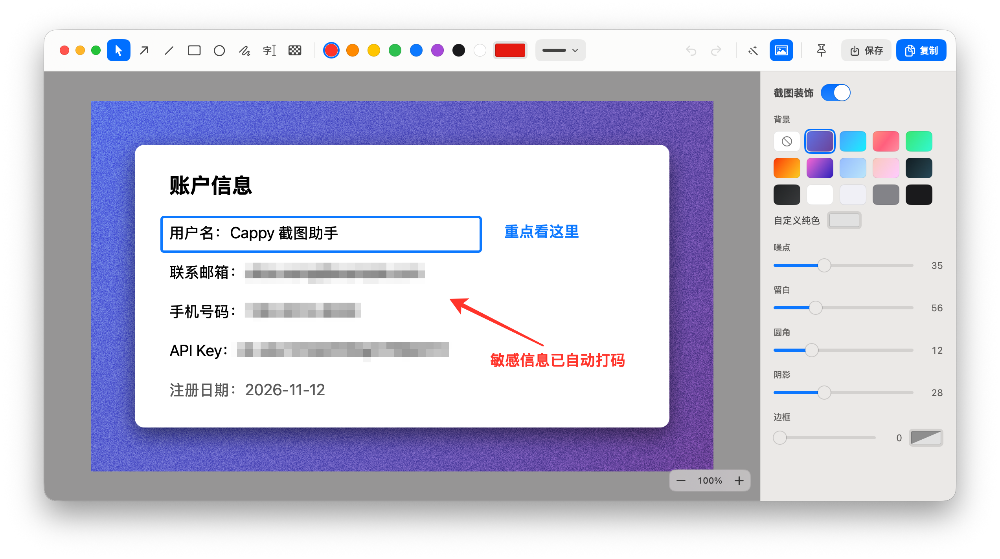

# Cappy

一个原生 macOS 截图应用：截完立刻标注、打码、加装饰，不用先保存。



菜单栏应用，使用 Swift + AppKit/SwiftUI + ScreenCaptureKit + Vision 编写，需要 macOS 14 或更高版本。

## 功能

| 功能 | 快捷键 | 说明 |
|---|---|---|
| 区域截图 | ⌃⌥A | 拖拽框选；按空格切换到窗口模式 |
| 窗口截图 | ⌃⌥S | 悬停高亮、点击截取 |
| 全屏截图 | ⌃⌥D | 截鼠标所在的显示器 |
| 滚动长截图 | ⌃⌥F | 框选区域后向下滚动（可自动滚动），自动拼接 |

快捷键可以在菜单栏的「快捷键设置…」里修改。

截图后直接进入编辑器：

- **标注**：箭头、直线、矩形、椭圆、画笔、文字、马赛克
- **选取文字**：用选择工具直接在图上拖选文字（OCR，支持中英文），⌘C 复制
- **智能马赛克**：自动给邮箱、电话、证件号、IP、密钥和人脸打码
- **装饰**：渐变 / 纯色 / 透明背景、颗粒噪点、留白、圆角、阴影、边框
- **悬浮**：⌘F 把成品图钉在屏幕最上层，可拖动、滚轮缩放，双击回到编辑，Esc 取消
- **最近截图**：保留最近 5 张截图及其标注，可随时重新编辑
- **画布**：滚轮缩放、按住空格拖拽平移

编辑完 ⌘C 复制或 ⌘S 保存。

## 安装

用 Homebrew 安装：

```sh
brew install --cask frostming/tap/cappy
```

或者从 [Releases](../../releases) 下载 `Cappy.app.zip`，解压后拖到「应用程序」。

安装包使用 Developer ID 签名并经过 Apple 公证，可以直接打开。

首次截图时系统会请求「屏幕录制」权限，授权后重新启动 Cappy。自动滚动另需「辅助功能」权限。
